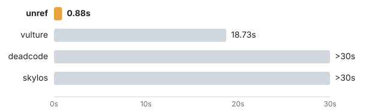

[](https://pypi.python.org/pypi/unref)
[](https://github.com/Apakottur/unref/blob/main/LICENSE)
[](https://pypi.python.org/pypi/unref)
[](https://unref.readthedocs.io/)

# unref

An extremely fast Python dead code finder, written in Rust.

<p align="center">
  
</p>

<p align="center">
  <i>Checking the whole <a href="https://github.com/python/cpython">CPython</a> codebase (v3.15.0, about 2,300 Python files),
  measured with <a href="https://github.com/Apakottur/unref/blob/main/scripts/benchmark.py"><code>scripts/benchmark.py</code></a>.</i>
</p>

- **Fast**: 20x faster than [vulture](https://github.com/jendrikseipp/vulture), it checks all of CPython's Python code in
  under a second.
- **Just works**: built-in rules for pytest, Django, Flask, Pydantic, SQLAlchemy and
  [more](https://unref.readthedocs.io/en/latest/frameworks/), so most projects need little or no
  configuration.
- **Flexible**: works for applications and libraries alike, see
  [what counts as dead code](https://unref.readthedocs.io/en/latest/faq/#what-counts-as-dead-code).
- **Modern**: follows the conventions of [Ruff](https://docs.astral.sh/ruff/) and [ty](https://docs.astral.sh/ty/).
- **Fits your workflow**: runs with `uvx`, as a pre-commit or prek hook, and in GitHub Actions.

**Documentation**: [unref.readthedocs.io](https://unref.readthedocs.io/)

## Getting Started

Run it with [`uvx`](https://docs.astral.sh/uv/):

```shell
$ uvx unref
src/project/models.py:12:7: unused-class 'Account'
src/project/utils.py:40:5: unused-function 'parse_date'
```

Or as a [pre-commit](https://pre-commit.com/) or [prek](https://prek.j178.dev/) hook, alongside
[Ruff](https://docs.astral.sh/ruff/):

```yaml
repos:
  - repo: https://github.com/astral-sh/ruff-pre-commit
    rev: v0.17.4
    hooks:
      - id: ruff-check
      - id: ruff-format
  - repo: https://github.com/Apakottur/unref
    rev: v0.4.0
    hooks:
      - id: unref
```

## Contributing

Bug reports and other feedback are welcome as [issues](https://github.com/Apakottur/unref/issues). To
contribute, see [CONTRIBUTING.md](https://github.com/Apakottur/unref/blob/main/CONTRIBUTING.md).
