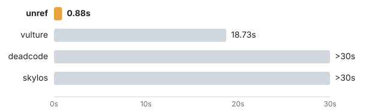

# unref

<p align="center">
  <em>An extremely fast Python dead code finder, written in Rust.</em>
</p>

<p align="center">
  <a href="https://pypi.python.org/pypi/unref"></a>
  <a href="https://github.com/Apakottur/unref/blob/main/LICENSE"></a>
  <a href="https://pypi.python.org/pypi/unref"></a>
</p>

---

**Documentation**: [unref.readthedocs.io](https://unref.readthedocs.io/)

**Source Code**: [github.com/Apakottur/unref](https://github.com/Apakottur/unref)

---

## Introduction

`unref` finds the functions, classes, methods, variables and attributes that nothing in a Python project
uses. Unused code piles up in every codebase, faster than ever now that AI tools write much of it, and
[Ruff](https://docs.astral.sh/ruff/) does not find it yet, see
[astral-sh/ruff#872](https://github.com/astral-sh/ruff/issues/872). The name is short for "unreferenced".

- **Fast**: 20x faster than [vulture](https://github.com/jendrikseipp/vulture), it checks all of CPython's Python
  code in under a second.
- **Just works**: built-in rules for pytest, Django, Flask, Pydantic, SQLAlchemy and
  [more](frameworks.md), so most projects need little or no configuration.
- **Flexible**: works for applications and libraries alike, see
  [what counts as dead code](faq.md#what-counts-as-dead-code).
- **Modern**: follows the conventions of [Ruff](https://docs.astral.sh/ruff/) and [ty](https://docs.astral.sh/ty/).
- **Fits your workflow**: runs with `uvx`, as a pre-commit or prek hook, and in GitHub Actions.

<p align="center">
  
</p>

## Example

```shell
$ uvx unref
src/project/models.py:12:7: unused-class 'Account'
src/project/utils.py:40:5: unused-function 'parse_date'
```

See [usage](usage.md) for the command line, pre-commit and prek, and GitHub Actions.
